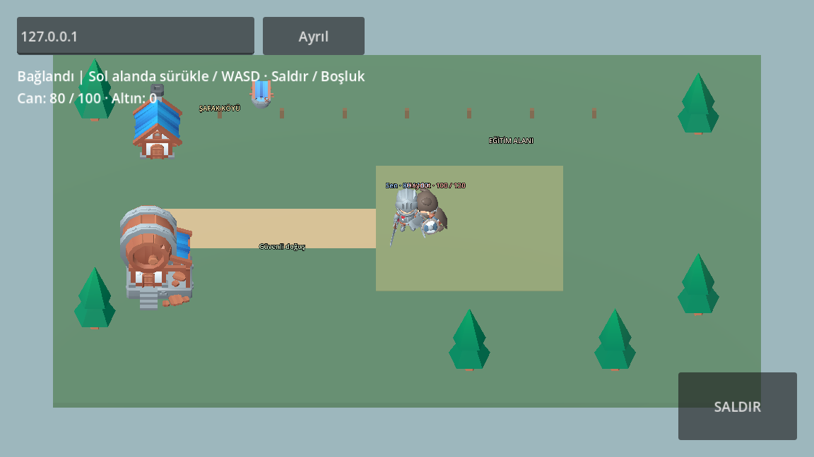

# Aetheria Android 0.5.0 - çevrim içi 3D deneme

[APK indir](./aetheria-online-android-v0.5.0.apk?raw=true) · [Godot kaynak projesi](./aetheria-online-godot-v0.5.0.zip?raw=true)

Android 7 veya üzeri, 64 bit ARM veya x86_64. Yatay ekran. Debug imzalı test paketi; mağaza sürümü değildir. Gerçek Android cihazda henüz test edilmedi.

KayKit CC0 karakterleri ve köy dekorasyonları, yürüme/saldırı animasyonları, sunucu kontrollü savaş, takip/geri dönüş, ölüm/yeniden doğma, konum ve altın kaydı bulunur. Bu küçük bir teknik denemedir; tamamlanmış MMORPG değildir.

**Sunucuya bağlanmadan yalnızca köy önizlemesi görünür.** Bu indirme herkese açık bir oyun sunucusu sağlamaz. Hareket ve savaş için Godot 4.6.3 ile bilgisayarda sunucuyu başlatın:

```sh
godot --headless --path godot res://online/arena.tscn -- --server
```

Telefon ile bilgisayarı aynı yerel ağa bağlayın. Telefonda adres alanına bilgisayarın LAN IP adresini yazıp Bağlan'a basın. UDP 24567 erişimi açık olmalıdır. `127.0.0.1` telefonda telefonun kendisidir ve bilgisayardaki sunucuya bağlanmaz. Aynı sunucuya iki telefon bağlanabilir. Sol tarafta parmak sürükleyerek hareket edin, SALDIR düğmesini kullanın.

Kaynak ZIP'i çıkarıp Godot proje yöneticisinden `godot/project.godot` dosyasını içe aktarın. Ayrıntılar `godot/online/README.md` içindedir. Karakter modeli tüm oyuncular için aynıdır; sınıflar, görev, envanter, güvenli hesap girişi ve PostgreSQL henüz eklenmedi.

Testler: iki gerçek ENet istemcisinin ortak düşman/ödülü, sunucu yeniden başlatıldıktan sonra konum/altın geri yükleme, takip ve güvenli yeniden doğma, yerel sunucuya bağlı OpenGL 3D görüntüleme. APK imzası ve 16 KiB hizalaması kontrol edildi. Bu kontroller fiziksel Android testi yerine geçmez.

Sanat: Kay Lousberg / KayKit, CC0. Kaynak ZIP ve APK lisans belgelerini içerir.


